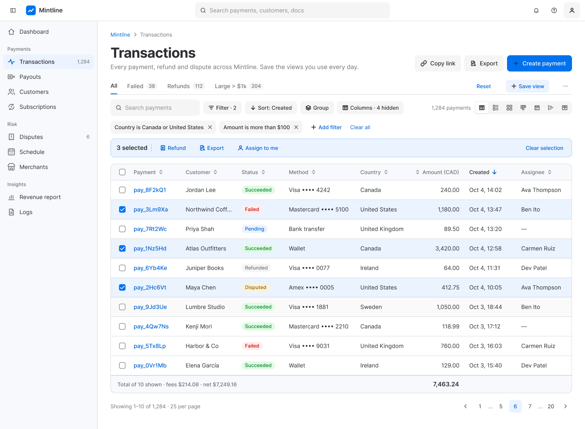
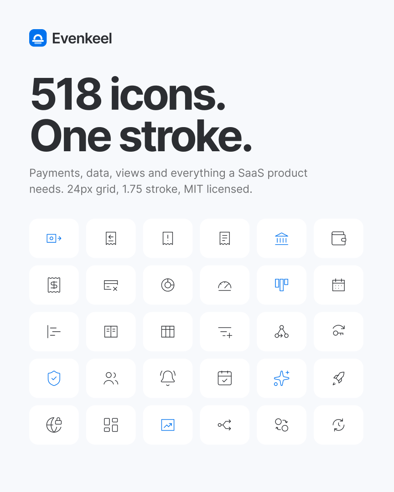
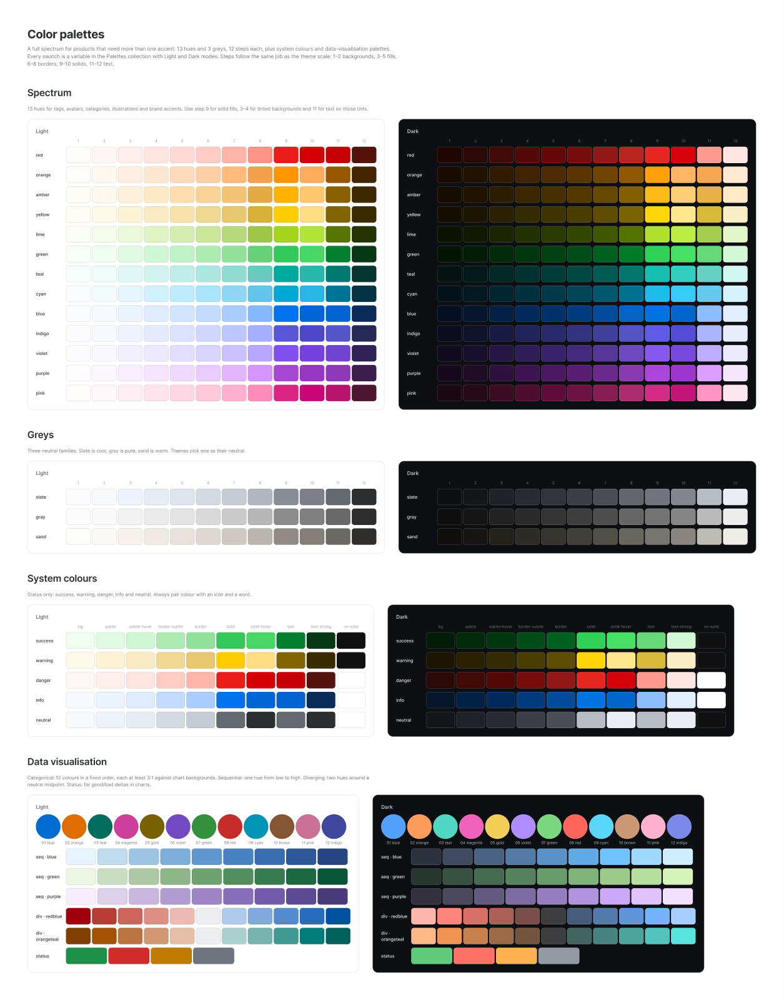
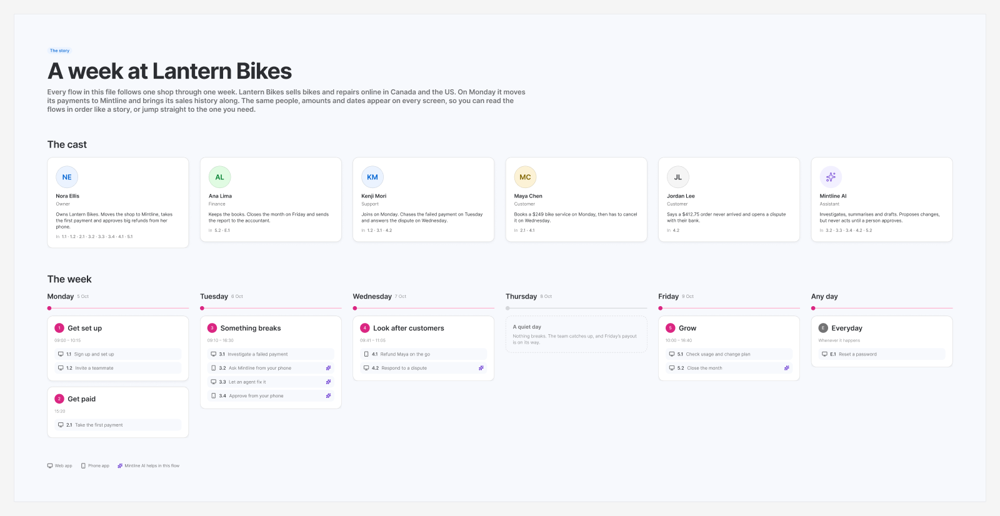
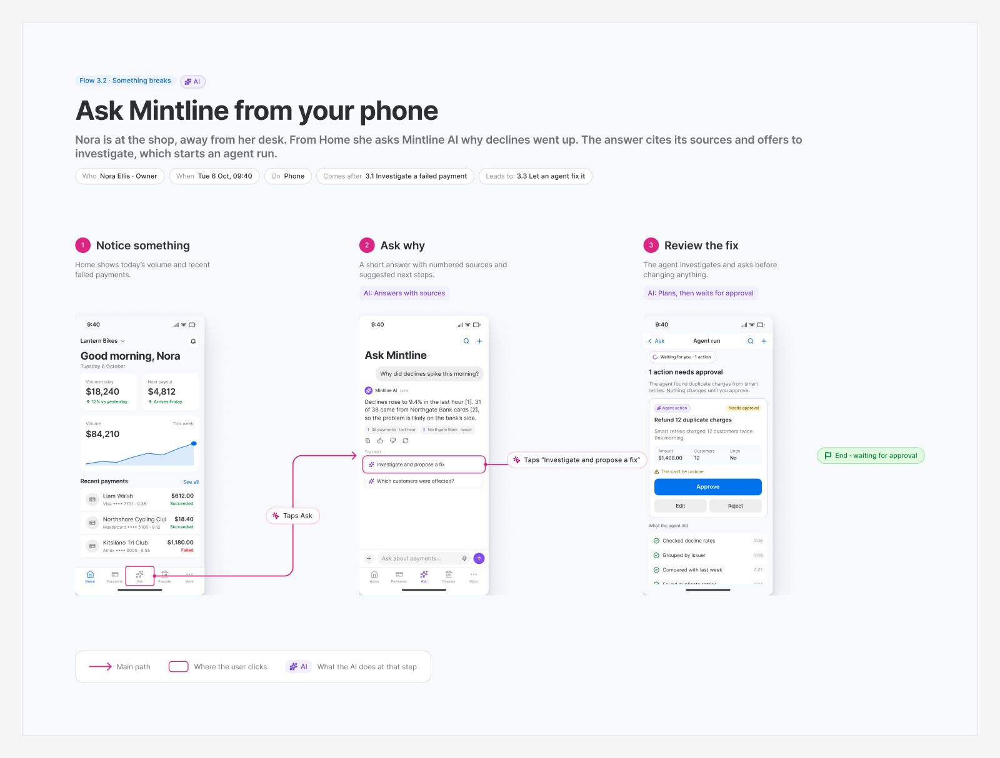

<div align="center">

# Evenkeel

**Calm interfaces for dense data.**

A themeable design system for data-heavy web apps, in Figma and React.

[](https://www.npmjs.com/package/evenkeel-ui)
[](https://www.figma.com/community/file/1691663776222213480/evenkeel-design-system)
[](LICENSE)
[](https://github.com/saishmenon/evenkeel/actions/workflows/ci.yml)
[](https://saishmenon.github.io/evenkeel/)

[Storybook](https://saishmenon.github.io/evenkeel/) ·
[Figma Community file](https://www.figma.com/community/file/1691663776222213480/evenkeel-design-system) ·
[Start here](START_HERE.md) ·
[Getting started](docs/getting-started.md) ·
[Theming](docs/theming.md) ·
[Changelog](CHANGELOG.md)


</div>

Evenkeel is a design system for the screens people stare at all day: dashboards, tables, logs, settings, billing. It lives in two places at once, a **Figma library** and a **React package**, and every token, text style and component has the **same name in both**. Change a theme in code and the Figma variables have a mode that matches; pick a variant in Figma and the React prop has the same name.

The examples and demos use **Mintline**, a fictional payments platform (transactions, payouts, disputes, API and webhook logs).

## Why Evenkeel

- **Built for density.** Two densities, tables and data views that stay legible at 32px rows, charts tuned for small multiples, numbers that line up.
- **Themeable, not just recolourable.** A theme is five knobs (accent, neutral, shape, display font, text font). Everything else, about 150 colours plus radii and fonts, is generated and contrast-checked.
- **One source for design and code.** Tokens are generated once and feed both the CSS and the Figma variables. A parity check fails the build if they drift.
- **Accessible by default.** Every theme × mode is checked for WCAG AA contrast, and every story is scanned with axe (WCAG 2.2 AA rules) in CI.
- **Open.** MIT-licensed code, a free Figma Community file, no account or licence key.

## Features

| | |
|---|---|
| **Tokens** | Primitives → theme → colour roles → foundations (space, radius, type, depth, materials, motion). CSS custom properties plus `tokens.json`. |
| **Themes** | 4 built-in themes (Default, Graphite, Ember, Studio) and `applyTheme()` for custom themes at runtime. |
| **Light and dark** | Every theme in both modes. Follows the OS by default; `data-mode` forces one. |
| **Densities** | Comfortable and compact. Changes spacing and control heights, never text size. |
| **Components** | 48 React components with matching Figma components and variants. |
| **Charts** | Bar, line, area and stacked charts, donut, bar list, sparkline, gauge and heatmap. |
| **Data views** | Table, list, grid, board, calendar, timeline and split views over the same records, sharing search, filters, sorting and grouping. |
| **Colour palettes** | A 13-hue spectrum, static grey scales, and data-visualisation palettes (categorical, sequential, diverging), in light and dark. |
| **Icons** | 518 icons: Evenkeel's own line icons plus a curated [Lucide](https://lucide.dev) set, all on the same 24px grid. |
| **Illustrations** | 17 spot illustrations for empty states, onboarding, errors and success that follow the theme. |
| **Brand and marketing** | The Evenkeel mark and lockup (`brand/`), a brand guide, and 12 editable marketing templates in Figma: social posts, banners, Open Graph, GitHub preview, Community cover, slides, release card and email header. |
| **AI** | 31 AI components (prompt input, citations, agent plan, approval card, inline assist, summaries and more), 9 AI patterns with 7 principles, and 7 AI page templates. Agents never act without a person approving. |
| **Mobile app (Figma)** | Phone foundations, components and 16 Mintline app screens, with 3 phone flows inside the story. Not in code yet. |
| **Patterns** | Payments list, payment details, create flow, dashboard, empty states, expressive theming. |
| **Templates** | 20+ page templates: full-page table, list, grid, board, calendar, timeline and split views; account (settings, billing, team, activity); auth; data (reports, logs, compare). |
| **User flows** | Click-through flows that tell one story, a week at Lantern Bikes: sign up, take the first payment, fix a spike in declines with an AI agent, answer a dispute, close the month. Mirrored in Figma as screens and arrows. |
| **Accessibility tooling** | Contrast check for every theme × mode, axe scan of every story, Figma parity check. |

<table>
  <tr>
    <td></td>
    <td></td>
  </tr>
  <tr>
    <td></td>
    <td></td>
  </tr>
</table>

## See it

Every screen tells one story: **a week at Lantern Bikes**, an online bike shop that moves its payments to Mintline. New here? Read **[Start here](START_HERE.md)**.

<table>
  <tr>
    <td colspan="2"></td>
  </tr>
  <tr>
    <td></td>
    <td></td>
  </tr>
  <tr>
    <td></td>
    <td></td>
  </tr>
</table>

## Install

```sh
npm i evenkeel-ui
```

React 18 or newer is a peer dependency.

## Quick start

**1. Import the stylesheet once**, at the root of your app. It contains every token, the base styles and every component's CSS.

```js
import 'evenkeel-ui/css';
import 'evenkeel-ui/fonts.css'; // optional: Inter + Bricolage Grotesque (needs a bundler)
```

**2. Pick a theme, mode and density** with attributes on `<html>` (or on any element, to theme part of a page). All three are optional.

```html
<html data-theme="default" data-mode="dark" data-density="compact">
```

| Attribute | Values | Default |
|---|---|---|
| `data-theme` | `default` · `graphite` · `ember` · `studio` | `default` |
| `data-mode` | `light` · `dark` (omit to follow the OS) | OS setting |
| `data-density` | `comfortable` · `compact` | `comfortable` |

**3. Use components.**

```tsx
import { Button, Badge } from 'evenkeel-ui';

export function Payouts() {
  return (
    <>
      <Button variant="filled" iconLeft="plus">Create payment link</Button>
      <Badge tone="success">Paid</Badge>
    </>
  );
}
```

**4. Make it yours (optional).** Generate a custom theme at runtime from the same five knobs the built-in themes use:

```ts
import { applyTheme, clearTheme } from 'evenkeel-ui';

applyTheme(document.documentElement, {
  accent: { light: '#FF5A1F' },   // dark is derived if omitted
  neutral: 'sand',                 // 'slate' | 'gray' | 'sand'
  shape: 'round',                  // 'sharp' | 'soft' | 'round'
  displayFont: 'Bricolage Grotesque',
  textFont: 'Inter',
});

clearTheme(document.documentElement, 'default'); // back to a preset
```

More in [Getting started](docs/getting-started.md).

### What's in the package

| Import | What you get |
|---|---|
| `evenkeel-ui` | React components, `applyTheme`, `clearTheme`, `presets` (ESM + CommonJS, TypeScript types) |
| `evenkeel-ui/css` (alias `evenkeel-ui/evenkeel.css`) | One stylesheet: tokens + base + components |
| `evenkeel-ui/tokens.css` | Tokens only (themes, colour roles, foundations), no component styles |
| `evenkeel-ui/fonts.css` | Optional web fonts via `@fontsource` |
| `evenkeel-ui/icons` | Icon path data, for use without React |
| `evenkeel-ui/tokens.json` | The token data, shaped for the Figma sync and other tools |

## Theming in one minute

Evenkeel's tokens come in four layers. You usually only touch the top one.

1. **Primitives:** 12-step OKLCH colour scales, generated and checked for contrast.
2. **Theme:** five knobs that pick scales, radii and fonts (`data-theme`, or `applyTheme()`).
3. **Roles:** colours named by job, such as `--color-label-primary`, `--color-background-primary`, `--color-border-focus`. Each holds a light and a dark value via `light-dark()`.
4. **Foundations:** space, radius, type, depth, motion and density.

Components only read roles and foundations, so a new theme restyles everything without touching component CSS. See [Theming](docs/theming.md) and [Tokens](docs/tokens.md).

## Figma library

The Figma library is published on the Figma Community: **[Evenkeel on Figma Community](https://www.figma.com/community/file/1691663776222213480/evenkeel-design-system)**.

Duplicate it, publish it as a library in your team, and the variable collections map straight onto the CSS:

| Figma collection | Modes | Code |
|---|---|---|
| Theme | Default · Graphite · Ember · Studio | `data-theme` |
| Color | Light · Dark | `data-mode` / `light-dark()` |
| Density | Comfortable · Compact | `data-density` |
| Size | – | `--space-*`, `--radius-*` |
| Motion | – | `--duration-*`, `--easing-*` |
| Palettes | Light · Dark | `--ek-<hue>-<step>`, `--ek-viz-*` |

A Figma variable `label/secondary` is the CSS variable `--color-label-secondary`. Full guide: [docs/figma.md](docs/figma.md).

The file also has a **Brand** page (logo, colour, type, motif, voice) and a **Marketing** page of templates. Every marketing template is a component with editable text properties. To use them in **Figma Buzz**, copy a frame into a Buzz file and set it up as a Buzz template there.

## Browser support

Evenkeel targets current evergreen browsers: **Chrome and Edge 123+, Firefox 120+, Safari 17.5+**.

Colour roles use the CSS [`light-dark()`](https://developer.mozilla.org/en-US/docs/Web/CSS/color_value/light-dark) function, and some foundations use `color-mix()` and `linear()` easing. Evenkeel does not ship a fallback for older browsers: colour roles will not resolve there. If you must support them, run the stylesheet through [`@csstools/postcss-light-dark-function`](https://www.npmjs.com/package/@csstools/postcss-light-dark-function) (part of `postcss-preset-env`), which rewrites `light-dark()` into custom-property toggles.

## Documentation

- [Start here](START_HERE.md): a ten-minute walkthrough
- [Getting started](docs/getting-started.md)
- [Theming](docs/theming.md)
- [Tokens](docs/tokens.md)
- [Figma library](docs/figma.md)
- [Accessibility](docs/accessibility.md)
- [Publishing (maintainers)](docs/publishing.md)
- [Storybook](https://saishmenon.github.io/evenkeel/): every component, pattern, template, flow and demo, with usage guidance

## Develop locally

```sh
git clone https://github.com/saishmenon/evenkeel.git
cd evenkeel
npm ci
npm run storybook        # tokens + Storybook on http://localhost:6006
npm test                 # WCAG contrast (every theme × mode) + Figma parity
npm run build            # tokens + library build to dist/
```

## Contributing

Contributions are welcome, in code and in Figma. Read [CONTRIBUTING.md](CONTRIBUTING.md) first; it explains how to keep Figma and code in step. Please follow the [Code of Conduct](CODE_OF_CONDUCT.md), and report security issues as described in [SECURITY.md](SECURITY.md).

## Licence

- **Code** (this repository and the `evenkeel-ui` package): [MIT](LICENSE), © the Evenkeel authors (see LICENSE).
- **Figma Community file:** published under [CC BY 4.0](https://creativecommons.org/licenses/by/4.0/), as all Figma Community files are.
- **Third-party:** icons from [Lucide](https://lucide.dev) (ISC), fonts Inter and Bricolage Grotesque (SIL Open Font License 1.1), and other dependencies. See [THIRD_PARTY_NOTICES.md](THIRD_PARTY_NOTICES.md).
