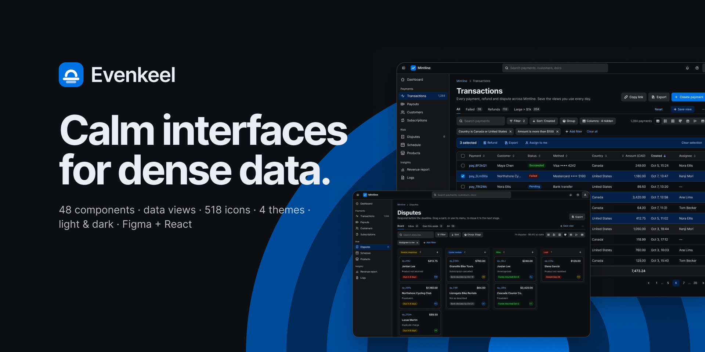
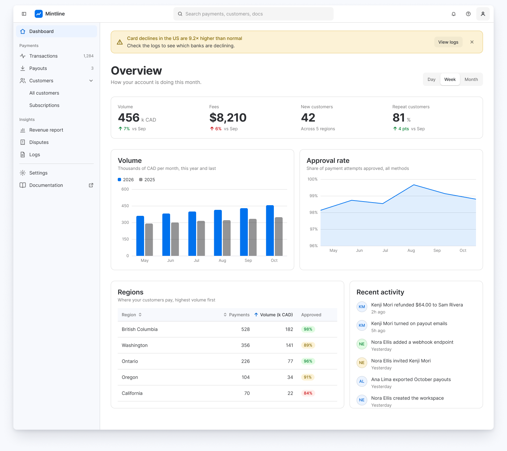
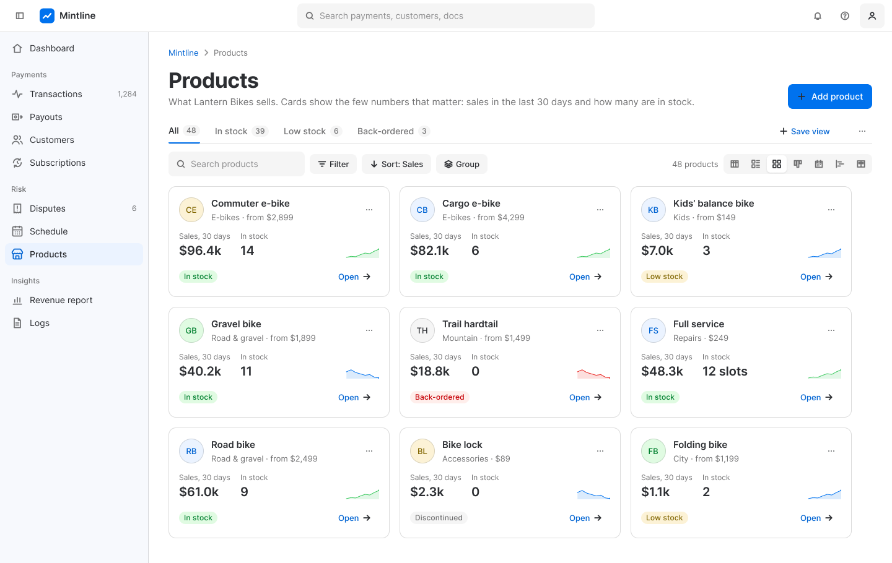
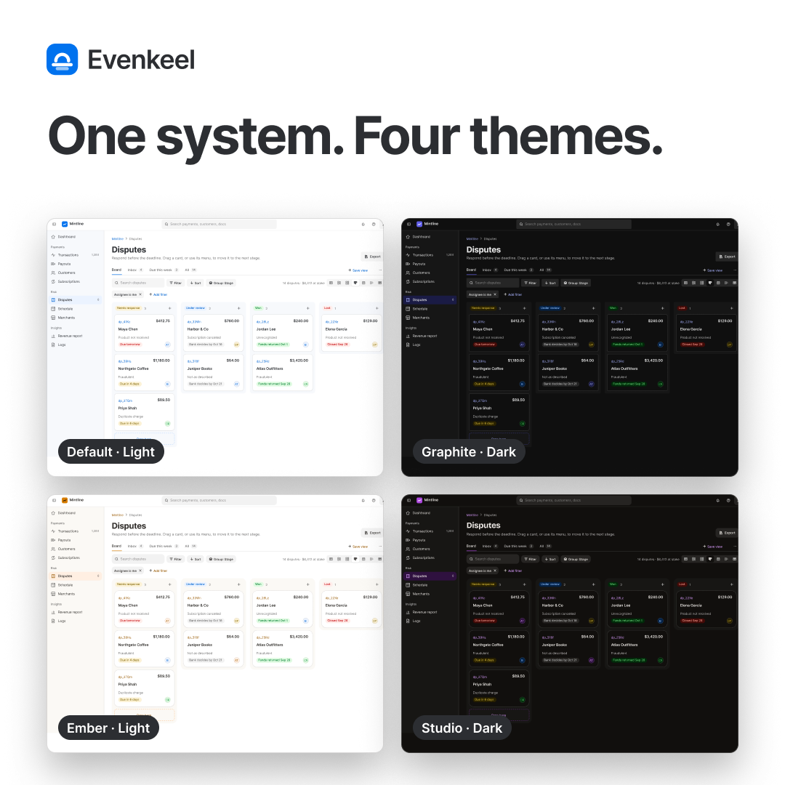
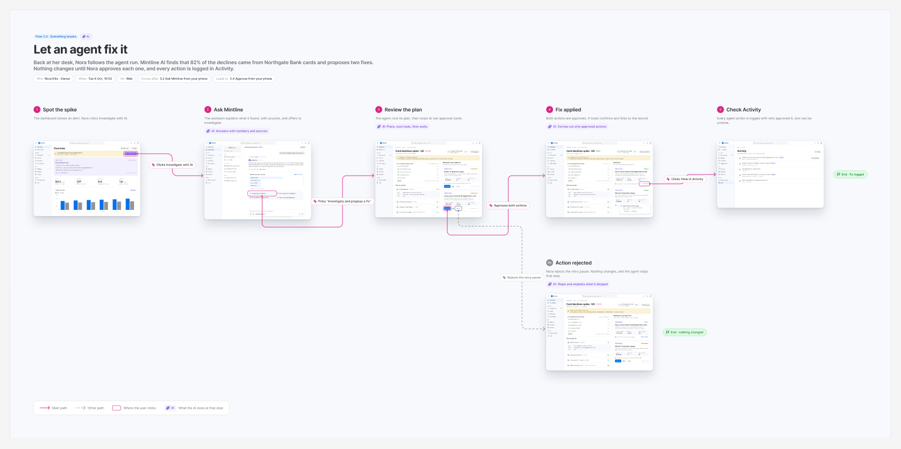

# Evenkeel

A design system for data-heavy web apps, in Figma and React.

[](https://www.npmjs.com/package/evenkeel-ui)
[](https://github.com/saishmenon/evenkeel/actions/workflows/ci.yml)
[](LICENSE)

[Figma file](https://www.figma.com/community/file/1691663776222213480/evenkeel-design-system) · [Storybook](https://saishmenon.github.io/evenkeel/) · [Changelog](CHANGELOG.md)



Evenkeel is for the screens people look at all day: dashboards, tables, logs, settings. The Figma library and the React package use the same names for every token and component, so a variant in Figma is a prop in code.

It comes with 48 components, charts, seven data views (table, list, grid, board, calendar, timeline, split), four themes in light and dark, and two densities. Every theme is checked against WCAG AA.

The examples use Mintline, a made-up payments app, and follow one shop, Lantern Bikes, through a week.

## Install

```sh
npm i evenkeel-ui
```

Needs React 18 or newer.

## Use it

Import the stylesheet once, then use components:

```tsx
import 'evenkeel-ui/css';
import { Button, Badge } from 'evenkeel-ui';

export function Example() {
  return (
    <>
      <Button variant="filled" iconLeft="plus">Create payment link</Button>
      <Badge tone="success">Paid</Badge>
    </>
  );
}
```

Theme, mode and density are attributes. Put them on `<html>`, or on any element to change part of a page:

```html
<html data-theme="graphite" data-mode="dark" data-density="compact">
```

Themes are `default`, `graphite`, `ember` and `studio`. Leave out `data-mode` to follow the OS. To make your own theme, see [Theming](docs/theming.md).

## Screenshots

| | |
|---|---|
|  |  |
|  |  |

## Docs

- [Getting started](docs/getting-started.md)
- [Theming](docs/theming.md)
- [Tokens](docs/tokens.md)
- [Using the Figma file](docs/figma.md)
- [Accessibility](docs/accessibility.md)

Evenkeel uses `light-dark()` and `color-mix()`, so it needs a recent browser: Chrome and Edge 123+, Firefox 120+, Safari 17.5+.

## Run it locally

```sh
git clone https://github.com/saishmenon/evenkeel.git
cd evenkeel
npm ci
npm run storybook
```

Contributions are welcome. See [CONTRIBUTING.md](CONTRIBUTING.md).

## License

Code is [MIT](LICENSE). The Figma file is CC BY 4.0, like every Figma Community file. Icons include a set from [Lucide](https://lucide.dev) (ISC), and the fonts are Inter and Bricolage Grotesque (OFL). See [THIRD_PARTY_NOTICES.md](THIRD_PARTY_NOTICES.md).
